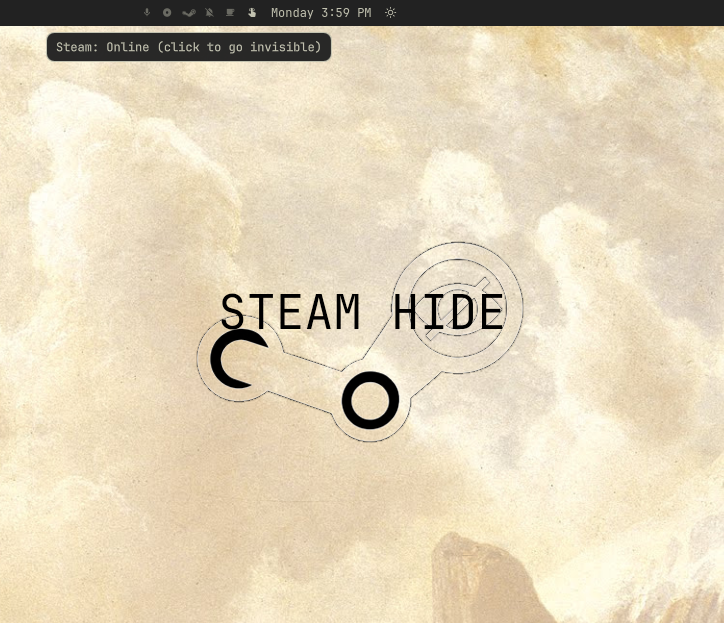

# Steam Status Toggle

An [Omarchy](https://omarchy.org/) bar widget that switches your Steam friends status between **Online** and **Invisible** with one click.



## Features

- One click to go invisible, one click to come back online
- Shows the Steam logo while you're online and a crossed-out eye while you're invisible
- Dims when Steam isn't running
- Reads the status Steam actually saved, so the icon stays correct even if you change it from inside Steam
- Works with native and Flatpak Steam

## Install

```bash
omarchy plugin add https://github.com/michaelsucks/SteamStatusToggle --enable
```

## Usage

Click the icon in the bar to toggle. Hover it to see your current status.

### Keybinding / scripting

While the widget is on the bar it exposes an IPC target, so you can bind it to a key in `~/.config/hypr/bindings.lua`:

```bash
omarchy-shell io.github.michaelsucks.steam-status-toggle toggle
omarchy-shell io.github.michaelsucks.steam-status-toggle refresh
```

The bundled helper script also works on its own, from the plugin folder:

```bash
./steam-status-toggle status     # prints "<running> <state>", e.g. "1 7"
./steam-status-toggle online
./steam-status-toggle invisible
./steam-status-toggle toggle
```

## How it works

Status changes go through Steam's own `steam://friends/status/<online|invisible>` URLs. The current status is read from `ePersonaState` in the signed-in account's `userdata/<id>/config/localconfig.vdf`, and the widget checks it every 3 seconds.

## Requirements

- Omarchy with the Quickshell-based Omarchy shell
- Steam (native at `~/.local/share/Steam` or `~/.steam/steam`, or the `com.valvesoftware.Steam` Flatpak)

## License

MIT
